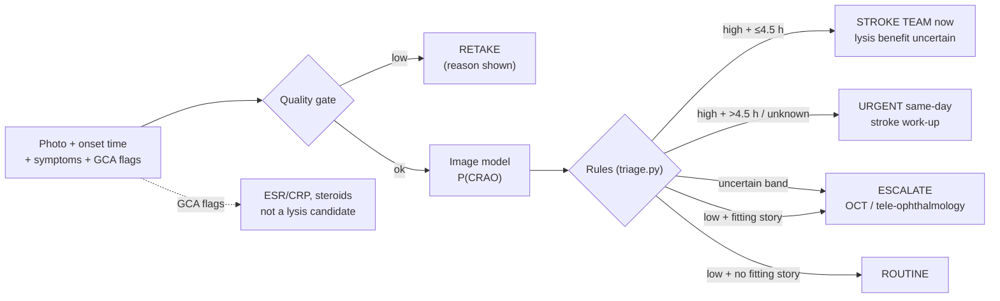

# Enhancing CRAO AI detection: what to build and an easy hackathon prototype

Prepared for the Siriraj x MIT Hackathon "Agentic Healthcare: From Models to Trustworthy Medicine", Cardiovascular track. Date: 2026-10-17.
Base paper: Gungor, Sarbout et al., "AI-Based Detection of CRAO Within 4.5 Hours on Standard Fundus Photographs", JAHA 2025 (`CRAO-AI-detection.md`).
Evidence notes: `outputs/.drafts/crao-ai-detection-prototype-research-{literature,clinical,data,build}.md`. Citation tags: [L#] literature, [C#] clinical, [D#] data, [B#] build note source numbers.
Prototype code: `experiments/crao-prototype/`.

---

## Executive summary

- **The base paper solves the "reading" problem but not the "pathway" problem.** Its CNN found hyperacute CRAO with AUC 0.96 and sensitivity 92.6% (50 of 54) where stroke neurologists reached 50–63% [L1]. Its training CRAO photos were all 24 h–30 d old, every test CRAO had an abnormal fundus, it used standard cameras only, and it excluded poor-quality images [L1].
- **The clinical payoff has shifted since the paper.** Both phase-3 thrombolysis RCTs within 4.5 h were null: THEIA 66% vs 48% (p=0.95) [C3], and TenCRAOS 20% vs 24% with one fatal brain bleed [C4]. REVISION stopped for futility [C5]. AHA 2026 calls IV thrombolysis for CRAO "uncertain" (class 2b) [C11]. *Inference:* pitch the tool as "catch the eye stroke and start a same-day stroke work-up", not "enable the clot-buster".
- **The strongest reason to catch CRAO fast is the stroke that follows.** Stroke/heart-attack risk peaks in days 1–7 after CRAO (IRR 44.5) [C12]. 15–32% have acute or silent brain infarcts on MRI [C15][C16][C17]. New AF is found in about half within 2 years [C19], and severe carotid stenosis in up to 40% [C18].
- **Recommended enhanced version ("Eye-Stroke Navigator"):** a rule-based agent around the image model. It adds (1) a quality gate with "retake" advice, (2) onset-time and symptom intake, (3) a rule that a normal-looking photo never reassures a patient with sudden one-eye vision loss, (4) a giant cell arteritis (GCA) red-flag branch, (5) an abstain band that escalates to OCT or tele-ophthalmology, and (6) a stroke work-up checklist. An LLM may only write the summary, never make the call.
- **A working prototype already exists** in `experiments/crao-prototype/`: quality gate, the paper's preprocessing, training script, rule-based triage and a Gradio UI. All self-checks pass, a 1-epoch training run completed, and the app served on localhost. **No accuracy has been measured**; it needs real data.
- **Data ceiling (must say on stage):** only about 151 public retinal-artery-occlusion images exist (Mendeley, CC BY 4.0), and none is labelled hyperacute [D8]. A public-data prototype can show "RAO vs look-alikes", not the paper's 4.5 h result.

---

## 1. What the base paper did and what it left open

| Item | Base paper [L1] | Open gap |
|---|---|---|
| Task | 4 classes: CRAO, CRVO, NAION, normal | Closed set. Multi-disease eyes and poor images were excluded |
| Training data | 1,039 photos, 517 patients; CRAO photos 24 h–30 d after onset | No hyperacute training data anywhere [L, Q7] |
| Hyperacute test | 54 CRAO photos (<4.5 h); AUC 0.96, sens 92.6%, spec 85.0% | Small n; every test CRAO had an abnormal fundus |
| Cameras | Standard desktop cameras only | Handheld, smartphone and widefield untested for CRAO [L, Q3] |
| Clinical context | Image only | No onset time, symptoms or GCA screen |
| Code/data | Data "on reasonable request"; no public code or weights [D, Q5] | Cannot be rebuilt from public material |

**Why the "abnormal fundus" gap matters.** In the Emory ED eye-stroke protocol, colour photos detected 68.7% (11/16) of retinal ischaemia within 4.5 h, against 93.7% for OCT, and 19% of eyes were diagnosed by OCT alone [C31]. Only 61% of the colour photos were of adequate quality [C31]. An early CRAO can look nearly normal on a photo [C34][L8].

---

## 2. What changed in the clinical evidence (pitch framing)

| Evidence | Result | Source |
|---|---|---|
| THEIA (alteplase vs aspirin, ≤4.5 h, n=70) | ≥0.3 logMAR gain 66% vs 48%; p=0.95; "likely underpowered" | [C3] |
| TenCRAOS (tenecteplase vs aspirin, n=78) | Good vision 20% vs 24%; p=0.69; one fatal ICH | [C4] |
| REVISION (≤12 h, n=127) | Terminated for futility at interim analysis; no results posted | [C5] |
| Observational IPD meta-analysis (n=783) | IV thrombolysis <4.5 h: recovery 28.8% vs 11.1% | [C6] |
| AHA/ASA 2026 guideline | IV thrombolysis "usefulness ... is uncertain" (2b, C-LD), via a secondary quote | [C11] |
| ESO 2025 | "suggest thrombolysis within 4.5 h"; very-low evidence, weak | [C10] |

Observational studies are positive and RCTs are not; the outcome definitions also differ [C, conflicts]. *Inference:* the defensible benefit of fast CRAO detection is **getting the patient into stroke care and work-up during the high-risk first week**, and into trials where available. The base paper itself frames its value as "improving patient selection for fibrinolytic trials and secondary stroke prevention" [C52].

**Why CRAO is missed today.**
- Only 25.6% of Swiss CRAO patients arrived within 4 h (symptom-to-door 852 min vs 300 min for stroke), and only 28.6% of the public recognised CRAO symptoms [C25].
- In a US cohort, only 32.8% of those reaching care within 4.5 h saw an ophthalmologist within 4.5 h [C26].
- Emergency physicians reading non-mydriatic photos had 46% sensitivity [C30].

**Thai context.**
- Ophthalmologists number 1.7 per 100,000 (2024) and are classed as a "scarce" specialty [C45]. In 2008, 45.7% worked in Bangkok, and 73.7% of provinces were below the WHO target [C44].
- NHSO's stroke fast track pays for rt-PA in ischaemic stroke coded I63; the NHSO document does not mention retinal artery occlusion (H34) [C46]. Whether CRAO is covered is **unverified**.
- Siriraj already has a 2003–2022 acute CRAO cohort (HBOT study) [C48], a possible local validation source subject to ethics approval.
- No Thai CRAO incidence was found. Korea reports 1.8–2.25 per 100,000 person-years [C22][C24].

---

## 3. The enhanced version: what to add, ranked

Ranking is the lead's inference from impact on safety and feasibility in 24–48 h.

| # | Enhancement | Why (evidence) | Effort |
|---|---|---|---|
| 1 | **Rule-based triage card** (stroke team / urgent work-up / escalate / retake / routine) with onset time | The value is the pathway [C12][C19]; LLMs fail guidelines and can be persuaded [B3][B4] | Low: built |
| 2 | **"Normal photo ≠ safe" rule:** a negative image with sudden one-eye loss <24 h escalates | Photos missed ~31% of early ischaemia vs OCT [C31]; training data were late-stage [L1] | Low: built |
| 3 | **Quality gate with retake reason** | 21% of images were rejected in Thai DR clinics (lighting, camera faults, no dilation) [B7]; 39% of ED CRAO photos were inadequate [C31] | Low (heuristic, built); medium (EyeQ-trained model [B10][B11]) |
| 4 | **GCA red-flag branch** → ESR/CRP, steroids, not a lysis candidate | Arteritic CRAO is <5% but threatens the other eye; trials exclude it [C36][C38]; GCA is rare in Asians [C41][C42] | Low: built |
| 5 | **Abstain band + calibration** → "uncertain: OCT / tele-ophthalmology" | Temperature scaling [B18]; uncertainty-based referral [B17]; conformal sets [B19]; deferral reduced false positives 25% in breast screening [B21] | Low (band built); medium (calibration) |
| 6 | **Stroke work-up checklist** (MRI-DWI, carotid imaging, ECG + prolonged AF monitoring, echo, lipids/HbA1c) | Work-up yields: carotid ≥70% in 40%, AF 20% [C18]; AF ~50% at 2 y [C19] | Low: built (short form) |
| 7 | **Foundation-model backbone** (FLAIR Apache-2.0, or RETFound non-commercial) | Label-efficient on small data [B24][D22]; no published RAO baseline exists [L, Q4] | Medium |
| 8 | **Anti-automation-bias UI:** clinician records a first impression before seeing the AI | Reader accuracy fell to 20–46% when the AI was wrong [B5] | Low (not built) |
| 9 | **OCT branch** | OCT found ischaemia when photos did not [C31][L8][L10]; OCT DL reached AUC 0.99 on n=50 CRAO (not hyperacute-specific) [L7] | High |
| 10 | **Handheld camera** | Optomed Aurora gradability matched tabletop in DR [D23]; transfer is disease-dependent [L20] | High (hardware) |

**What not to do.**
- Don't let a multimodal LLM read the photo. On fundus images GPT-4o scored 75%, the others 14–18% [L30], and ChatGPT-4 failed on CRAO [L29].
- Don't present Grad-CAM as a lesion map. Saliency methods fail randomisation and localisation tests [B12][B15][B16], and heatmaps reduced accuracy on normal fundus images [B14].

---

## 4. The easy prototype (built and checked)

`experiments/crao-prototype/`:

| File | What it does | Check run |
|---|---|---|
| `vision.py` | Quality score (field of view, exposure, sharpness) + base-paper preprocessing (CLAHE on LAB-L, dilation + median-blur background subtraction) | Self-check passed: synthetic good 0.91 > blurred 0.03 and dark 0.00 |
| `triage.py` | Deterministic rules above; thresholds are placeholders | 10 asserts passed (stroke, urgent, escalate, normal-fundus escalate, routine, retake, no-model, GCA) |
| `train.py` | timm `efficientnet_b0` (ImageNet), class-weighted loss, crao vs other | 1 epoch on 16 synthetic images ran and saved weights. A macOS DataLoader pickling bug was found and fixed |
| `app.py` | Gradio UI: photo, hours since onset, symptom and GCA checkboxes → preprocessed image, quality, P(CRAO), triage card | `run()` tested on the no-model, model, GCA and low-quality paths; server returned HTTP 200 |

Environment used: Python venv with torch 2.14.1, timm 1.0.30, gradio 6.30.0, opencv 5.0.0 (command output, plan verification log). **Synthetic-data metrics are meaningless and are not reported.** The base paper's preprocessing kernel sizes are not given in the paper; the values in `vision.py` are guesses to tune.

**Data recipe** (from [D]):

| Class | Source | Licence | Count |
|---|---|---|---|
| CRAO/RAO | Mendeley RAO fundus dataset v2 (Yoo 2024) [D8] | CC BY 4.0 | 151 (127 web-crawled + 16 JSIEC + 8 RFMiD) |
| Mimics | RFMiD 1.0 [D4]: CRVO 45, BRVO 119, disc oedema 96, AION 26 | CC BY 4.0 | as listed |
| Normal | RFMiD 1.0 normal 669 [D4]; AIROGS (CC BY-NC-ND) [D12] | mixed | 669+ |
| Quality-gate training (optional) | EyeQ labels on EyePACS images [D11][B10] | code CC BY-NC-SA | 28,792 |

**Leakage warning:** FLAIR and RetiZero were pretrained on RFMiD and JSIEC, and the Mendeley set reuses JSIEC and RFMiD images [D, implications]. Hold out the web-crawled subset and report results by source.

**Compute:** RETFound ViT-L fine-tuning took about 1.2 h per 1,000 images on one T4 [B24]. The default `efficientnet_b0` should be faster, but this was not measured.

**Demo hosting:** run locally with `share=True` and a password (`auth=`), using public or synthetic images only, because Gradio share links are public and expire after a week [B29]. Creating a new CPU Gradio Space now needs Hugging Face PRO ($9/month); free accounts can host up to 2 ZeroGPU Gradio Spaces [B27][B28].

---

## 5. Trust, reporting and regulation

- **Humans stay in control:** WHO's six AI-for-health principles [B37]. Every card ends "decision support only".
- **Thai FDA SaMD guidance (Oct 2024):** AI diabetic-retinopathy screening is Class 2, and ischaemic-stroke diagnosis software is Class 3 [B39]. *Inference:* a CRAO triage tool would likely be Class 3, but the guide has no CRAO example (medium confidence).
- **PDPA s.26:** health data need explicit consent or a listed exception such as research with safeguards [B41] (unofficial translation). Strip EXIF and IDs before upload.
- **Reporting:** TRIPOD+AI for model development [B33]; DECIDE-AI for a first live pilot [B36].
- **Licences:** RETFound, VisionFM, RAONet, AIROGS, EyeQ and EDDFS are non-commercial, and RetiZero is academic-only. FLAIR (Apache-2.0) plus CC BY datasets is the commercially safer stack [D, implications].

---

## 6. Caveats and disagreements

- **Thrombolysis evidence conflicts.** Observational meta-analyses are positive [C6][C7][C8]; the RCTs are null [C3][C4][C5]. Outcome definitions differ; do not pool them on a slide.
- **The AHA 2026 class 2b wording** comes from a secondary source (Guideline Central); the primary was blocked [C11]. ESO 2025's abstract and full text disagree ("recommend" vs "suggest") [C10].
- **Near-perfect RAO AUCs elsewhere** (Cen 2021 ≈1.0; UWF 1.000 on 3 images) come from late or mixed-stage RAO and are not comparable to the 0.96 hyperacute result [L4][L5].
- **The base paper's public "CRAO" images** (16 from JSIEC) are a combined RAO class that may include branch occlusions, and its 66 "CRVO" equal JSIEC CRVO + BRVO [D, Q1] (inference).
- **Stroke risk:** relative risk is high early (IRR 44.5) [C12], but absolute risk in a population cohort was 2.2% within ±15 days [C13]. Both can be true.
- **Recent agent papers** (EyeAgent, the glaucoma agent) are preprints with small test sets [B1][B2].
- **The prototype's quality score** is a hand-tuned heuristic tested only on synthetic images.

## 7. Open questions

1. Is CRAO (H34.1) eligible for the NHSO stroke fast track and its rt-PA payment? (Not found.)
2. Can Siriraj's CRAO cohort [C48] supply hyperacute photos for local validation? (Needs ethics approval and data access.)
3. What are the real per-class RAO numbers for RetiZero (in its supplement) and ReVision? (Not read.)
4. What thresholds give ≥90% sensitivity on held-out real data? (Not measured.)
5. Which cameras do Thai stroke-fast-track EDs actually have, if any? (Not found.)

## 8. Next steps for the team (24–48 h)

1. Download the Mendeley RAO set and RFMiD 1.0, build `data/` with a patient/source-level split, and run `train.py` (README).
2. Set `P_HIGH`/`P_LOW` on the validation split for high sensitivity, and report sensitivity/specificity with confidence intervals and by source.
3. If time allows, swap in a FLAIR backbone and add temperature scaling.
4. Demo script: a late CRAO photo → URGENT; the same photo with onset 2 h → STROKE TEAM; a dark photo → RETAKE; a normal photo with sudden loss at 3 h → ESCALATE; GCA ticked → steroid branch.
