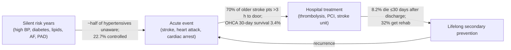

# Defining the cardiovascular problem in Thailand (5 Ws), problem first

Prepared for the Siriraj x MIT Hackathon "Agentic Healthcare: From Models to Trustworthy Medicine", Cardiovascular Diseases track. Date: 2026-10-16.
Evidence notes: `outputs/.drafts/cvd-problem-definition-thailand-research-{burden,acute,prevention,solutions}.md`. Numbered citations refer to the Sources list at the end.

---

## Executive summary

- **The single biggest "leak" in Thai cardiovascular care happens before anyone feels sick.** In the 2019–20 national health examination survey, 25.7% of Thai adults had hypertension. Only 51.5% of them knew it, and only 22.7% had it under control. Control had *fallen* from 30% in 2014, even though universal coverage makes hypertension treatment free [11].
- **The second leak is the hours between symptom onset and the hospital door.** In a northern Thai study, 70% of older adults with ischaemic stroke arrived more than 3 hours after onset [15]. In a 2025 sample, the mean delay was 253 minutes (about 4.2 hours), which researchers say "effectively precluded" thrombolysis for most of them [16]. Hospital-side fast tracks cannot recover time that was lost at home.
- **The third leak is the first month after discharge.** In a national cohort of 888,003 Thai ischaemic-stroke patients, more died within 30 days after discharge (8.2%) than in hospital (6.4%) [9]. Only 32% of Thai stroke patients received rehabilitation [10].
- **Recommended problem for the team (inference from the evidence weighting in §2):** *Most Thai adults with high blood pressure are not diagnosed or not controlled, and nothing currently notices or acts on that between clinic visits, even though treatment is free.* It sits upstream of heart attack, stroke and PAD, it has the strongest national data, it is getting worse, and its benefit is quantified: each 10 mmHg drop in systolic BP cuts major CV events by about 20% [35].
- **Alternate problems** with full 5 Ws are given for (B) stroke recognition-to-door delay and (C) the post-discharge danger window.
- **Hackathon numbers check:** "over half a billion affected" [2] and "~20 million deaths a year" [1][2] are verified. "80,000 Thai deaths" and "one-third of Thais" are **not verified** in this run. GBD (via the World Heart Federation) estimates **120,370** CVD deaths in Thailand [5], and adult hypertension prevalence is about 26–29% [5][11]. Quote sourced numbers in the pitch, not the brief's numbers.

---

## 1. The landscape: where Thai patients are lost along the CVD journey

Globally, CVD killed an estimated 19.8 million people in 2022 (about 32% of all deaths), 85% of them from heart attack and stroke. More than three-quarters of CVD deaths occur in low- and middle-income countries [1]. The World Heart Federation reports that more than half a billion people are affected and that up to 80% of premature heart attacks and strokes are preventable [2]. About 236.6 million people aged 25 and over were living with PAD in 2015, 72.9% of them in low- and middle-income countries [14].

| Stage | Key Thai evidence | Size of the gap |
|---|---|---|
| Silent risk (prevention) | HTN prevalence 25.7%; aware 51.5%; treated 47.9%; controlled 22.7% (2019–20) [11]. Diabetes 10.1%; aware 62.8%; treated 42.9%; controlled 20.5% (2020) [12] | Large and worsening for HTN control |
| Silent risk: AF | Thai AF patients on anticoagulants: only 34.4% knew missed-dose management; age ≥75 linked to low knowledge (aOR 2.11) [28] | Population undiagnosed AF burden **not measured** in sources found (data gap) |
| Silent risk: PAD | PAD 7.2% by ABI in Thai T2DM primary care [29]; 17.7% in Asian high-risk T2DM incl. Thailand [30]; critical limb ischaemia HR 5.26 for death vs asymptomatic PAD [31] | Under-measured; detected late |
| Acute: stroke | 70% of older patients >3 h [15]; mean delay 253 min in a 2025 sample [16]; early academic fast track gave rt-PA to 5.5% of ischaemic strokes [18] | Large; national IVT rate **not found** |
| Acute: STEMI | Registry time-to-treatment medians 240–359 min (2002–2008) [20][21]; provinces outside Bangkok with >50% PCI grew from 4 to 37 (2011–2017); reperfusion lowers 30-day mortality by 14.1–19.6 percentage points [22] | Improving, but uneven geographically |
| Acute: cardiac arrest | 30-day survival 3.4%; bystander CPR 40.4%; bystander AED use 0.8% (3 centres, 2017–2020) [23] | Very large |
| Post-discharge | 8.2% ≤30-day post-discharge mortality vs 6.4% in-hospital [9]; 32% received rehab; care outside Bangkok associated with higher mortality [10] | Large |

---

## 2. Candidate problem statements, weighed

Scoring is the lead's judgement (inference) based on the evidence above. 3 = strong, 1 = weak.

| Criterion | A. Undetected / uncontrolled hypertension | B. Stroke recognition-to-door delay | C. First 30 days after discharge |
|---|---|---|---|
| Size of population affected | 3 (about 1 in 4 adults [11]) | 2 (349,126 stroke patients in 2023 [6]) | 2 (all discharged stroke/ACS pts) |
| Strength of Thai national data | 3 (four NHES cycles [11]) | 1 (small single-region studies [15][16]) | 2 (national claims cohorts [9][10]) |
| Trend | 3 (worsening control [11]) | 1 (unknown) | 1 (unknown) |
| Quantified benefit if fixed | 3 (RCT meta-analysis [35]) | 3 (IPD meta-analysis on time [25]) | 1 (Thai data observational [10]) |
| Upstream of heart + brain + limbs | 3 | 1 (brain only) | 2 |
| Fits "agentic" between-visit support | 3 | 2 | 3 |
| **Total** | **18** | **10** | **11** |

**Recommendation:** lead with **A**. B is the most emotionally vivid story and could be the pitch's opening hook. C is a strong alternative if the team has access to Siriraj discharge workflows.

---

## 3. Problem A (recommended): silent, uncontrolled high blood pressure

### Problem statement
Half of Thai adults with high blood pressure don't know they have it, and fewer than 1 in 4 have it under control [11]. This is true even though treatment is free. High BP has no symptoms, so the first sign is often a stroke, a heart attack or kidney damage.

### What
- **The actual problem:** high BP goes undetected, and once detected it is not controlled. Of every 10 Thai adults with hypertension, about 5 are unaware, about 5 are treated and about 2 are controlled (arithmetic from NHES 2019–20 percentages [11]).
- **Impact:** WHO lists high blood pressure first among the 10 modifiable risk factors behind most of the global stroke burden [4]. Thailand recorded 349,126 stroke patients and 36,214 stroke deaths in 2023 [6]. GBD estimates 120,370 CVD deaths in Thailand [5].
- **If not fixed:** the trend already points the wrong way. Control fell from 30% (2014) to 22.7% (2019–20), and awareness slipped from 55.8% to 51.5% [11]. Diabetes prevalence rose from 7.5% to 10.1% (2004–2020) [12]. The mean age of stroke onset in Thailand is 65 [8], so an ageing population will turn more uncontrolled-BP years into strokes, heart attacks, PAD and dependency. This is an inference from the trends; no Thai projection was found in this run.
- **If fixed:** every 10 mmHg reduction in systolic BP lowers major CV events by 20% (RR 0.80, 95% CI 0.77–0.83) and coronary heart disease by 17% (RR 0.83), per a meta-analysis of 123 trials and 613,815 participants [35]. A community health worker-led program in rural Bangladesh, Pakistan and Sri Lanka achieved an extra 5.2 mmHg reduction over 24 months [36]. Among Thai hypertensives, IHD prevalence fell from 56.6 to 34.5 per 1,000 between 2011 and 2018 under universal coverage [37], so access helps, but the control gap remains.
- **Current solutions and shortcomings:**
  - *Free UHC primary care:* removes cost, not the detection or follow-up gap. Awareness and control stalled or fell [11].
  - *Thai CV risk score / DSMES education:* a cluster RCT (n=693) found no change in Thai CV risk score or HbA1c at 12 months for nurse-led or peer-assisted arms [38].
  - *Health-literacy and chatbot programs:* small samples (n=58 [39], n=68 [40]). The chatbot study is non-randomised, and its authors call the findings "preliminary" [40].
  - *Village health volunteer (VHV) and community-leader telehealth:* feasible and acceptable (92–97%) [34], but outcome data are lacking, and VHVs face workload and policy constraints [32].
  - *2024 Thai HTN guideline:* recommends home or ambulatory BP to confirm diagnosis and adds a "BP at risk" (130–139/80–89) category [26]. Whether home BP is actually being used at scale was not verified.

### Who
- Thai adults with hypertension (prevalence 25.7%; men 26.8%, women 24.6%), especially the roughly half who are unaware [11].
- Older adults and rural residents. A rural cohort showed 7.9% of hypertensives at >20% 10-year CV risk (12.7% of men) [13]. Stroke mortality is higher for patients treated outside Bangkok [10].
- Families and caregivers who absorb disability after a stroke (inference; not quantified here).
- Front-line workers: VHVs and sub-district health-promoting hospital staff who do screening and follow-up [32][34].

### When
- **When it occurs:** silently, over years to decades before an event, and between clinic visits, when no one is measuring or adjusting. This is an inference from the asymptomatic nature of hypertension [3]; the 2024 Thai guideline's push for out-of-office BP supports it [26].
- **When it must be fixed:** before the first event. The WHO target to cut uncontrolled hypertension by 25% between 2010 and 2025 has passed its deadline [3], and the global goal to cut premature NCD mortality by one-third by 2030 is four years away [44].

### Where
- Community and home settings: villages, sub-district health-promoting hospitals, rural northeast and north (where several of the cited studies were run [13][39]). The gap is upstream of hospitals.
- Not mainly in tertiary hospitals like Siriraj, which see the consequences (inference).

### Why it matters
- One upstream risk factor drives events in all three of the track's organs: heart, brain and limbs [1][4][14].
- It is cheap to measure, effective treatment is free [11], and the benefit is proven [35]. The failure is in detection, follow-up and titration, the process gap that agentic, trustworthy AI could plausibly address (inference; no tool evaluated here). Any such tool must meet WHO's six consensus principles for ethical AI in health [43].

### Problem pitch (illustrative template; replace with a real story from your team or patients)
> *My grandmother lives in a village in Isan. She felt fine, so she never went back after the health volunteer told her once that her blood pressure was "a bit high". Her pills were free at the health centre, but nobody checked whether she took them or whether they worked. The first time a doctor saw her again was in the stroke unit. Half of Thais with high blood pressure don't know they have it, and fewer than 1 in 4 have it controlled, so the first symptom is often a stroke.*

The persona is fictional. Only the closing statistics are sourced [11].

---

## 4. Problem B (alternate): stroke recognition-to-door delay

| W | Evidence-based answer |
|---|---|
| **What** | Older Thai patients with stroke reach hospital too late for clot-busting treatment: 70% arrive more than 3 h after onset (n=120, northern Thailand) [15], with a mean of 253 min in a 2025 sample (n=106) [16]. Each minute of a typical large-vessel stroke destroys about 1.9 million neurons [24]. Alteplase within 3 h gives good outcomes in 32.9% vs 23.1% with control (OR 1.75). Beyond 4.5 h the benefit is no longer significant (OR 1.15, 95% CI 0.95–1.40) [25]. |
| **If not fixed** | Fast tracks and stroke units keep improving hospital-side time [18][19], but late arrivers cannot benefit. Long-term burden persists: 4-year survival after incident stroke is 66.5% [10]. |
| **If fixed** | More patients reach hospital within the window where thrombolysis clearly helps [25]. |
| **Current solutions** | F.A.S.T. public campaigns [6]; hospital stroke fast track (cut time to CT from ~2.5 h) [18]; stroke units in all advanced-level but only 55% of mid-level referral hospitals [19]; LINE sticker education for VHVs (knowledge outcome only) [33]; telestroke consultation (in a Thai-supported Lao programme only 14% of 205 patients arrived within 4.5 h) [45]. **Shortcomings:** they act after the patient decides to go. Delay is linked to low perceived severity and distance from hospital [15]. In a rural southern Thai survey, 99 of 113 high-risk people "had a low to no chance awareness of their risk to stroke" [17]. |
| **Who** | Older adults (mean onset age 65 [8]), people living far from hospital [15], family bystanders (inference). |
| **When** | In the minutes to hours after symptoms start, often at home. Must be fixed within the 4.5 h window [25]. |
| **Where** | Homes and villages, especially rural areas; distance is a key predictor [15]. |
| **Why** | Time-dependent benefit is among the best-proven effects in stroke medicine [24][25]. |

**Data gap:** national Thai thrombolysis rate and 1669 EMS use for stroke were not found. Ask Siriraj stroke clinicians or NIEMS for these at the hackathon.

---

## 5. Problem C (alternate): the first 30 days after discharge

| W | Evidence-based answer |
|---|---|
| **What** | After ischaemic stroke, 8.2% of Thai patients die within 30 days of discharge, more than the 6.4% who die in hospital (n=888,003) [9]. Only 32% of stroke patients received rehabilitation [10]. Early post-discharge deaths are mostly from the stroke itself; later deaths are mostly from complications (pneumonia, sepsis) and comorbidities [9]. |
| **If not fixed** | Preventable deaths and complications continue. Haemorrhagic stroke has the highest cost per patient, and rehabilitation was associated with lower costs [10]. |
| **If fixed** | Rehabilitation and thrombolysis were associated with lower mortality in national claims [10] (observational; not proof of cause). |
| **Current solutions** | Home-based rehabilitation offered at 100% of mid-level but only 16% of advanced-level referral hospitals (survey with 32% response) [19]. In AF, patients who survive a major bleed face 4.44-fold higher adjusted death risk [27], and anticoagulant knowledge gaps are common [28]. |
| **Who** | Stroke and ACS survivors, especially older patients and those treated outside Bangkok [10], plus family caregivers (inference). |
| **When** | Days 0–30 after discharge, then lifelong [9]. |
| **Where** | At home, far from the treating hospital (inference). |
| **Why** | The handover from hospital to home is where the system loses track of the patient (inference from [9][10]). |

---

## 6. Caveats and disagreements

- **Prompt figures vs sources.** Thai CVD deaths: 120,370 (GBD via WHF [5]) vs "80,000" (hackathon brief, source unknown). MOPH registered 36,214 stroke deaths in 2023 [6], and a Thai review cites more than 65,000 heart-disease deaths a year [7]. Definitions differ (modelled vs registered causes). The WHF page labels the figure "2024" while its source note says 2021 [5].
- **"One-third of Thais"** could not be traced. The closest sourced figures are adult HTN prevalence of 25.7% (NHES, age-standardised [11]) and about 29% (WHF, 2019 [5]). Globally, 33% of adults aged 30–79 have hypertension [3].
- **Control rates depend on the denominator.** National survey control was 22.7% (all hypertensives) [11] vs 63.9% in a rural cohort of people already in care [13]. Both are consistent with most of the loss happening before people enter care (inference).
- **Problem A rests mainly on one national analysis.** The awareness, treatment and control figures come from a single NHES trend paper [11]. Prevalence is corroborated by WHF/GBD [5], and the parallel diabetes gap [12] points the same way, but the team should confirm the figures with the NHES VI report or Siriraj clinicians before quoting them on stage.
- **Acute-care Thai data are old or small.** ACS registries are from 2002–2008 [20][21]. Prehospital-delay studies have 106–120 patients each [15][16].
- **Observational associations** (rehab, PCI and mortality) may be confounded [10][22].
- **Global AI/digital evidence may not transfer.** The Apple Heart Study was a US smartwatch population: 0.52% were notified, only 450 of 2,161 notified participants returned analysable ECG patches, and 34% of those showed AF [41]. The EAGLE AI-ECG trial (US primary care) raised low-EF diagnosis from 1.6% to 2.1% [42].

## 7. Open questions to resolve at the hackathon

1. What is Thailand's current national IVT rate and the share of stroke/STEMI patients arriving by 1669 EMS? (Not found.)
2. What happens after a positive community BP screen: what fraction complete confirmation and start treatment? (Not found; this is the core metric for Problem A.)
3. How many VHVs are active, which digital tools do they use, and what is their workload? (Not verified.)
4. What are smartphone/LINE access and digital literacy among Thai adults over 60? (Not verified.)
5. What do Thai FDA (software as a medical device) and PDPA rules require for an AI agent that contacts patients? (Not verified.)
6. Where does the "80,000 deaths" figure in the brief come from?

## 8. Next steps (problem validation, not solution)

- Interview 2–3 Siriraj clinicians (cardiology, neurology, family medicine) and, if possible, one VHV, using the 5 W tables above.
- Get one real patient or family story for the pitch. Replace the illustrative template.
- Pick one measurable outcome (e.g., % of screened-positive adults with confirmed diagnosis and controlled BP at 90 days) before discussing any solution.

---

## Sources

1. WHO. Cardiovascular diseases (CVDs) — fact sheet. https://www.who.int/news-room/fact-sheets/detail/cardiovascular-diseases-(cvds)
2. World Heart Federation. World Heart Report 2023: Confronting the World's Number One Killer. https://world-heart-federation.org/wp-content/uploads/World-Heart-Report-2023.pdf
3. WHO. Hypertension — fact sheet. https://www.who.int/news-room/fact-sheets/detail/hypertension
4. WHO. Stroke — fact sheet. https://www.who.int/news-room/fact-sheets/detail/stroke
5. World Heart Federation. World Heart Observatory — Thailand country profile (IHME GBD data). https://world-heart-federation.org/world-heart-observatory/countries/thailand/
6. Department of Disease Control, MOPH Thailand. World Stroke Day 2023 press release (24 Oct 2023), in Thai. https://ddc.moph.go.th/brc/news.php?news=37914&deptcode=brc
7. Heart Disease and Stroke: Global Burden and Lessons from Thailand (TCI ThaiJo review). https://www.tci-thaijo.org/en/articles/health04-3603
8. Suwanwela NC. Stroke epidemiology in Thailand. J Stroke. 2014. https://pubmed.ncbi.nlm.nih.gov/24741559/
9. Long-term causes of death in 888,003 ischemic stroke patients in Thailand: nationwide retrospective study with 18-year follow-up. Ann Med. 2026. https://pubmed.ncbi.nlm.nih.gov/42504160/
10. Stroke resource utilisation and all-cause mortality in Thailand 2017–2020. BMJ Open. 2023. https://pubmed.ncbi.nlm.nih.gov/37280024/
11. Trends in hypertension prevalence, awareness, treatment, and control in the Thai population, 2004 to 2020. BMC Public Health. 2024. https://pubmed.ncbi.nlm.nih.gov/39538168/
12. Diabetes trends and determinants among Thai adults from 2004 to 2020. Sci Rep. 2025. https://pubmed.ncbi.nlm.nih.gov/40866600/
13. Clinical Epidemiology of Hypertension in Rural Thailand: A Nationwide Cross-Sectional Study. Glob Heart. 2025. https://pubmed.ncbi.nlm.nih.gov/41487451/
14. Song P, et al. Global, regional, and national prevalence and risk factors for peripheral artery disease in 2015. Lancet Glob Health. 2019. https://pubmed.ncbi.nlm.nih.gov/31303293/
15. Prehospital delay after acute ischemic stroke among Thai older adults: A cross-sectional study. Nurs Health Sci. 2023. https://pubmed.ncbi.nlm.nih.gov/36240046/
16. Factors Associated With Prehospital Delay Among Older Adults Surviving Ischemic Stroke. Brain Behav. 2026. https://pubmed.ncbi.nlm.nih.gov/42625133/
17. Knowledge and attitude towards stroke among the population of one rural community in southern Thailand. BMJ Open. 2024. https://pubmed.ncbi.nlm.nih.gov/38326263/
18. Stroke fast track reduces time delay to neuroimaging and increases use of thrombolysis in an academic medical center in Thailand. J Neuroimaging. 2012. https://pubmed.ncbi.nlm.nih.gov/21122006/
19. Availability of stroke services and hospital facilities at different hospital levels in Thailand. BMC Health Serv Res. 2022. https://pubmed.ncbi.nlm.nih.gov/36539806/
20. Demographic, management practices and in-hospital outcomes of Thai Acute Coronary Syndrome Registry (TACSR). J Med Assoc Thai. 2007. https://pubmed.ncbi.nlm.nih.gov/18431881/
21. Thai Registry in Acute Coronary Syndrome (TRACS). J Med Assoc Thai. 2012. https://pubmed.ncbi.nlm.nih.gov/22612004/
22. Access to reperfusion therapy and mortality outcomes in patients with STEMI under universal health coverage in Thailand. BMC Cardiovasc Disord. 2020. https://pubmed.ncbi.nlm.nih.gov/32143572/
23. Pre-hospital survival factors of out-of-hospital cardiac arrest patients in Thailand. Resusc Plus. 2022. https://pubmed.ncbi.nlm.nih.gov/35036967/
24. Saver JL. Time is brain—quantified. Stroke. 2006. https://pubmed.ncbi.nlm.nih.gov/16339467/
25. Emberson J, et al. Effect of treatment delay, age, and stroke severity on the effects of intravenous thrombolysis with alteplase. Lancet. 2014. https://pubmed.ncbi.nlm.nih.gov/25106063/
26. 2024 Thai guidelines on the treatment of hypertension. Asian Biomed. 2025. https://pubmed.ncbi.nlm.nih.gov/41728364/
27. Clinical outcomes of AF patients who survived from bleeding event: COOL-AF Thailand Registry. Thromb Haemost. 2024. https://pubmed.ncbi.nlm.nih.gov/38626898/
28. Knowledge of NOACs and associated factors among patients with AF: Thailand. Healthcare (Basel). 2026. https://pubmed.ncbi.nlm.nih.gov/42793518/
29. Prevalence and predictors of PAD by ABI in a diabetes population in lower northern Thailand. Diab Vasc Dis Res. 2020. https://pubmed.ncbi.nlm.nih.gov/33158366/
30. PAD-SEARCH: prevalence of PAD in Asian type 2 diabetes patients. Diabetes Res Clin Pract. 2007. https://pubmed.ncbi.nlm.nih.gov/16950543/
31. Incidence and predictors of CVD and all-cause mortality in T2DM patients with PAD. PLoS One. 2025. https://pubmed.ncbi.nlm.nih.gov/40378162/
32. Role and mental health practices of village health volunteers in rural Thailand (qualitative). PLoS One. 2025. https://pubmed.ncbi.nlm.nih.gov/40146743/
33. The effectiveness of the stroke sign by sticker among village health volunteers. J Educ Health Promot. 2024. https://pubmed.ncbi.nlm.nih.gov/39297115/
34. Feasibility of a telehealth platform for community-based NCD risk assessment by community health leaders in rural northern Thailand. SAGE Open Med. 2026. https://pubmed.ncbi.nlm.nih.gov/42405357/
35. Ettehad D, et al. Blood pressure lowering for prevention of cardiovascular disease and death. Lancet. 2016. https://pubmed.ncbi.nlm.nih.gov/26724178/
36. Jafar TH, et al. A Community-Based Intervention for Managing Hypertension in Rural South Asia (COBRA-BPS). N Engl J Med. 2020. https://pubmed.ncbi.nlm.nih.gov/32074419/
37. National Trends and Factors Associated with IHD Among Individuals with Hypertension in Thailand, 2011–2018. Glob Heart. 2026. https://pubmed.ncbi.nlm.nih.gov/41766720/
38. Self-management education and support for type 2 diabetes in Thailand: a cluster randomized trial. Lancet Reg Health Southeast Asia. 2026. https://pubmed.ncbi.nlm.nih.gov/42212245/
39. Transformative learning-based health literacy program for uncontrolled hypertension in Thailand: cluster RCT. Belitung Nurs J. 2026. https://pubmed.ncbi.nlm.nih.gov/42375857/
40. Chatbot-based hypertension management program among community-dwelling older adults. J Multidiscip Healthc. 2026. https://pubmed.ncbi.nlm.nih.gov/42820082/
41. Perez MV, et al. Large-Scale Assessment of a Smartwatch to Identify Atrial Fibrillation. N Engl J Med. 2019. https://pubmed.ncbi.nlm.nih.gov/31722151/
42. Yao X, et al. AI-enabled electrocardiograms for identification of patients with low ejection fraction: pragmatic RCT. Nat Med. 2021. https://pubmed.ncbi.nlm.nih.gov/33958795/
43. WHO. Ethics and governance of artificial intelligence for health. 2021. https://www.who.int/publications/i/item/9789240029200
44. World Heart Federation. World Heart Report 2023 microsite (quote: "reducing premature mortality from NCDs by one-third by 2030"). https://heartreport23.world-heart-federation.org/
45. The First 10 Thrombolysis for Acute Ischemic Stroke in Lao PDR under Teleconsultation from Thailand. J Stroke Cerebrovasc Dis. 2019. https://pubmed.ncbi.nlm.nih.gov/31530479/
