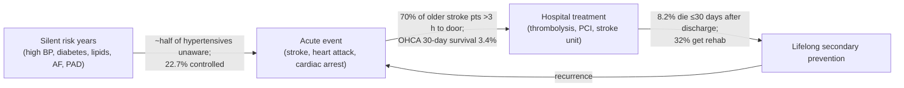

# Defining the cardiovascular problem in Thailand (5 Ws), problem first

Prepared for the Siriraj x MIT Hackathon "Agentic Healthcare: From Models to Trustworthy Medicine", Cardiovascular Diseases track. Date: 2026-10-16.
Evidence notes: `outputs/.drafts/cvd-problem-definition-thailand-research-{burden,acute,prevention,solutions}.md`.

---

## Executive summary

- **The single biggest "leak" in Thai cardiovascular care happens before anyone feels sick.** In the 2019–20 national health examination survey, 25.7% of Thai adults had hypertension. Only 51.5% of them knew it, and only 22.7% had it under control. Control had *fallen* from 30% in 2014, even though universal coverage makes hypertension treatment free (T1/T3).
- **The second leak is the hours between symptom onset and the hospital door.** In a northern Thai study, 70% of older adults with ischaemic stroke arrived more than 3 hours after onset. In a 2025 sample, the mean delay was about 4.2 hours, which researchers say "effectively precluded" thrombolysis for most of them (T2). Hospital-side fast tracks cannot recover time that was lost at home.
- **The third leak is the first month after discharge.** In a national cohort of 888,003 Thai ischaemic-stroke patients, more died within 30 days after discharge (8.2%) than in hospital (6.4%). Only 32% of Thai stroke patients received rehabilitation (T1/T2).
- **Recommended problem for the team (inference from the evidence weighting below):** *Most Thai adults with high blood pressure are not diagnosed or not controlled, and nothing currently notices or acts on that between clinic visits, even though treatment is free.* It sits upstream of heart attack, stroke and PAD, it has the strongest national data, it is getting worse, and its benefit is quantified: each 10 mmHg drop in systolic BP cuts major CV events by about 20% (T3).
- **Alternate problems** with full 5 Ws are given for (B) stroke recognition-to-door delay and (C) the post-discharge danger window.
- **Hackathon numbers check:** "over half a billion affected" and "~20 million deaths a year" are verified (WHF 2023; WHO). "80,000 Thai deaths" and "one-third of Thais" are **not verified** in this run. GBD (via the World Heart Federation) estimates **120,370** CVD deaths in Thailand, and adult hypertension prevalence is about 26–29%. Quote sourced numbers in the pitch, not the brief's numbers.

---

## 1. The landscape: where Thai patients are lost along the CVD journey

| Stage | Key Thai evidence | Size of the gap |
|---|---|---|
| Silent risk (prevention) | HTN prevalence 25.7%; aware 51.5%; treated 47.9%; controlled 22.7% (2019–20). Diabetes 10.1%; aware 62.8%; controlled 20.5% (2020) | Large and worsening for HTN control |
| Silent risk: AF | Thai AF patients on anticoagulants: only 34.4% knew missed-dose management; older age linked to low knowledge | Population undiagnosed AF burden **not measured** (data gap) |
| Silent risk: PAD | PAD in Thai T2DM primary care 7.2% (ABI); 17.7% in Asian high-risk T2DM; critical limb ischaemia HR 5.26 for death | Under-measured; detected late |
| Acute: stroke | 70% of older patients >3 h; mean delay 253 min in a 2025 sample; early academic fast track gave rt-PA to 5.5% of IS | Large; national IVT rate **not found** |
| Acute: STEMI | Registry time-to-treatment medians 4–6 h (2002–2008); PCI reach grew to 37 provinces with >50% PCI by 2017; reperfusion lowers 30-day mortality by 14–20 percentage points | Improving, but uneven geographically |
| Acute: cardiac arrest | 30-day survival 3.4%; bystander CPR 40.4%; bystander AED use 0.8% | Very large |
| Post-discharge | 8.2% ≤30-day post-discharge mortality vs 6.4% in-hospital; 32% received rehab; care outside Bangkok associated with higher mortality | Large |

---

## 2. Candidate problem statements, weighed

Scoring is the lead's judgement (inference) based on the evidence above. 3 = strong, 1 = weak.

| Criterion | A. Undetected / uncontrolled hypertension | B. Stroke recognition-to-door delay | C. First 30 days after discharge |
|---|---|---|---|
| Size of population affected | 3 (about 1 in 4 adults) | 2 (~349k stroke patients/yr) | 2 (all discharged stroke/ACS pts) |
| Strength of Thai national data | 3 (four NHES cycles) | 1 (small single-region studies) | 2 (national claims cohorts) |
| Trend | 3 (worsening control) | 1 (unknown) | 1 (unknown) |
| Quantified benefit if fixed | 3 (RCT meta-analysis) | 3 (IPD meta-analysis on time) | 1 (Thai data observational) |
| Upstream of heart + brain + limbs | 3 | 1 (brain only) | 2 |
| Fits "agentic" between-visit support | 3 | 2 | 3 |
| **Total** | **18** | **10** | **11** |

**Recommendation:** lead with **A**. B is the most emotionally vivid story and could be the pitch's opening hook. C is a strong alternative if the team has access to Siriraj discharge workflows.

---

## 3. Problem A (recommended): silent, uncontrolled high blood pressure

### Problem statement
Half of Thai adults with high blood pressure don't know they have it, and fewer than 1 in 4 have it under control. This is true even though treatment is free. High BP has no symptoms, so the first sign is often a stroke, a heart attack or kidney damage.

### What
- **The actual problem:** high BP goes undetected, and once detected it is not controlled. Of every 10 Thai adults with hypertension, about 5 are unaware, about 5 are treated and about 2 are controlled (arithmetic from NHES 2019–20 percentages).
- **Impact:** high BP is the leading modifiable driver of stroke burden (WHO lists it first among 10 modifiable stroke risk factors). Thailand recorded 349,126 stroke patients and 36,214 stroke deaths in 2023 (DDC/MOPH). GBD estimates 120,370 CVD deaths in Thailand (WHF profile).
- **If not fixed:** the trend already points the wrong way. Control fell from 30% (2014) to 22.7% (2019–20), and awareness slipped from 55.8% to 51.5%. Diabetes prevalence rose from 7.5% to 10.1% (2004–2020). With an ageing population (stroke mean onset age 65), more uncontrolled-BP years will turn into strokes, heart attacks, PAD and dependency. This is an inference from the trends; no Thai projection was found in this run.
- **If fixed:** every 10 mmHg reduction in systolic BP lowers major CV events by 20% (RR 0.80) and coronary heart disease by 17% (RR 0.83), per a meta-analysis of 123 trials and 613,815 participants. A community health worker-led program in rural South Asia achieved an extra 5.2 mmHg reduction over 24 months. Among Thai hypertensives, IHD prevalence fell from 56.6 to 34.5 per 1,000 between 2011 and 2018 under universal coverage, so access helps, but the control gap remains.
- **Current solutions and shortcomings:**
  - *Free UHC primary care:* removes cost, not the detection or follow-up gap. Awareness and control stalled or fell.
  - *Thai CV risk score / DSMES education:* a cluster RCT (n=693) found no change in Thai CV risk score at 12 months.
  - *Health-literacy and chatbot programs:* small samples (n=58, n=68). The chatbot study is non-randomised, and its authors call the findings "preliminary".
  - *Village health volunteer (VHV) and community-leader telehealth:* feasible and acceptable (92–97%), but outcome data are lacking, and VHVs face workload and policy constraints.
  - *2024 Thai HTN guideline:* recommends home or ambulatory BP to confirm diagnosis and adds a "BP at risk" (130–139/80–89) category. Whether home BP is actually being used at scale was not verified.

### Who
- Thai adults with hypertension (prevalence 25.7%, similar in men 26.8% and women 24.6%), especially the roughly half who are unaware.
- Older adults and rural residents. A rural cohort showed 7.9% of hypertensives at >20% 10-year CV risk (12.7% of men). Stroke outcomes are worse outside Bangkok.
- Families and caregivers who absorb disability after a stroke (inference; not quantified here).
- Front-line workers: VHVs and sub-district health-promoting hospital staff who do screening and follow-up.

### When
- **When it occurs:** silently, over years to decades before an event, and between clinic visits, when no one is measuring or adjusting (inference from asymptomatic nature; the 2024 guideline's push for out-of-office BP supports this).
- **When it must be fixed:** before the first event. The WHO target to cut uncontrolled hypertension by 25% (2010–2025) has passed its deadline, and the SDG target of cutting premature NCD mortality by one-third by 2030 is four years away.

### Where
- Community and home settings: villages, sub-district health-promoting hospitals, rural northeast and north (where several studies were done). The gap is upstream of hospitals.
- Not mainly in tertiary hospitals like Siriraj, which see the consequences.

### Why it matters
- One upstream risk factor drives events in all three of the track's organs: heart, brain and limbs.
- It is cheap to measure, effective treatment is free, and the benefit is proven. The failure is in detection, follow-up and titration, the process gap that agentic, trustworthy AI could plausibly address (inference; no tool evaluated here).

### Problem pitch (illustrative template; replace with a real story from your team or patients)
> *My grandmother lives in a village in Isan. She felt fine, so she never went back after the health volunteer told her once that her blood pressure was "a bit high". Her pills were free at the health centre, but nobody checked whether she took them or whether they worked. The first time a doctor saw her again was in the stroke unit. Half of Thais with high blood pressure don't know they have it, and fewer than 1 in 4 have it controlled, so the first symptom is often a stroke.*

---

## 4. Problem B (alternate): stroke recognition-to-door delay

| W | Evidence-based answer |
|---|---|
| **What** | Older Thai patients with stroke reach hospital too late for clot-busting treatment: 70% arrive more than 3 h after onset (n=120, northern Thailand), with a mean of 253 min in a 2025 sample. Each minute of a large-vessel stroke destroys about 1.9 million neurons. Alteplase within 3 h gives good outcomes in 32.9% vs 23.1% with control. Beyond 4.5 h the benefit is no longer significant. |
| **If not fixed** | Fast tracks and stroke units keep improving hospital-side time, but most patients cannot benefit. Disability and the 4-year mortality burden (66.5% 4-year survival) persist. |
| **If fixed** | More patients reach hospital within the window where thrombolysis clearly helps (OR 1.75 within 3 h). |
| **Current solutions** | FAST campaigns (DDC); hospital stroke fast track (cut time to CT from ~2.5 h); stroke units in all advanced-level but only 55% of mid-level referral hospitals; LINE sticker education for VHVs (knowledge only); telestroke. **Shortcomings:** they act after the patient decides to go. Delay is driven by low perceived severity, distance and decision delay. In a rural southern Thai survey, 99 of 113 high-risk people underrated their own stroke risk. |
| **Who** | Older adults (mean onset age 65), people living far from hospital, people living alone, family bystanders. |
| **When** | In the minutes to hours after symptoms start, often at home. Must be fixed within the 4.5 h window. |
| **Where** | Homes and villages, especially rural areas; distance is a key predictor. |
| **Why** | Time-dependent benefit is among the best-proven effects in stroke medicine. |

**Data gap:** national Thai thrombolysis rate and 1669 EMS use for stroke were not found. Ask Siriraj stroke clinicians or NIEMS for these at the hackathon.

---

## 5. Problem C (alternate): the first 30 days after discharge

| W | Evidence-based answer |
|---|---|
| **What** | After ischaemic stroke, 8.2% of Thai patients die within 30 days of discharge, more than the 6.4% who die in hospital (n=888,003). Only 32% of stroke patients received rehabilitation. Early post-discharge deaths are mostly from the stroke itself; later deaths are mostly from complications (pneumonia, sepsis) and comorbidities. |
| **If not fixed** | Preventable deaths, readmissions and recurrence continue; costs rise. Haemorrhagic stroke has the highest cost per patient, and rehabilitation was associated with lower costs. |
| **If fixed** | Rehabilitation and thrombolysis were associated with lower mortality in national claims (observational; not proof of cause). |
| **Current solutions** | Home-based rehabilitation offered at 100% of mid-level but only 16% of advanced-level referral hospitals (survey with 32% response). In AF, patients who survive a major bleed face 4.4-fold higher death risk, and gaps in anticoagulant knowledge are common. |
| **Who** | Stroke and ACS survivors, especially older patients and those outside Bangkok, plus family caregivers. |
| **When** | Days 0–30 after discharge, then lifelong. |
| **Where** | At home, far from the treating hospital. |
| **Why** | The handover from hospital to home is where the system loses track of the patient (inference from the data above). |

---

## 6. Caveats and disagreements

- **Prompt figures vs sources.** Thai CVD deaths: 120,370 (GBD via WHF) vs "80,000" (hackathon brief, source unknown). MOPH registered 36,214 stroke deaths in 2023, and a Thai review cites more than 65,000 heart-disease deaths a year. Definitions differ (modelled vs registered causes). The WHF page labels the figure "2024" while its source note says 2021.
- **"One-third of Thais"** could not be traced. The closest sourced figures are adult HTN prevalence of 25.7% (NHES, age-standardised) and 29% (WHF, 2019).
- **Control rates depend on the denominator.** National survey control was 22.7% (all hypertensives) vs 63.9% in a rural cohort of people already in care. Both are true: the loss happens mostly before people enter care.
- **Acute-care Thai data are old or small.** ACS registries are from 2002–2008. Prehospital-delay studies have 106–120 patients each.
- **Observational associations** (rehab, PCI and mortality) may be confounded.
- **Global AI/digital evidence may not transfer.** The Apple Heart Study and the EAGLE AI-ECG trial were US populations. In the Apple study only 450 of 2,161 notified participants returned analysable ECG patches, and the EAGLE gain was modest (2.1% vs 1.6%).

## 7. Open questions to resolve at the hackathon

1. What is Thailand's current national IVT rate and the share of stroke/STEMI patients arriving by 1669 EMS? (Not found.)
2. What happens after a positive community BP screen: what fraction complete confirmation and start treatment? (Not found; this is the core metric for Problem A.)
3. How many VHVs are active, which digital tools do they use, and what is their workload? (Not verified.)
4. What are smartphone/LINE access and digital literacy among Thai adults over 60? (Not verified.)
5. What do Thai FDA (software as a medical device) and PDPA rules require for an AI agent that contacts patients? (Not verified.)
6. Where does the "80,000 deaths" figure in the brief come from?

## 8. Next steps (problem validation, not solution)

- Interview 2–3 Siriraj clinicians (cardiology, neurology, family medicine) and, if possible, one VHV, using the 5 W tables above.
- Get one real patient or family story for the pitch. Replace the illustrative template.
- Pick one measurable outcome (e.g., % of screened-positive adults with confirmed diagnosis and controlled BP at 90 days) before discussing any solution.
