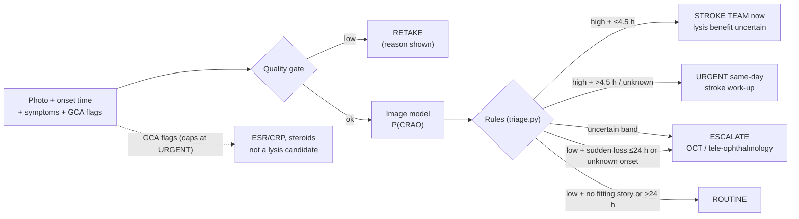

# Enhancing CRAO AI detection: what to build and an easy hackathon prototype

Prepared for the Siriraj x MIT Hackathon "Agentic Healthcare: From Models to Trustworthy Medicine", Cardiovascular track. Date: 2026-10-17.
Base paper: Gungor, Sarbout et al., "AI-Based Detection of CRAO Within 4.5 Hours on Standard Fundus Photographs", JAHA 2025 (`CRAO-AI-detection.md`).
Evidence notes: `outputs/.drafts/crao-ai-detection-prototype-research-{literature,clinical,data,build}.md`. Numbered citations refer to the Sources list at the end.
Prototype code: `app/` (the first prototype in `experiments/crao-prototype/` was ported there and removed; see git history).

---

## Executive summary

- **The base paper solves the "reading" problem but not the "pathway" problem.** Its CNN found hyperacute CRAO with AUC 0.96 and sensitivity 92.6% (50 of 54 CRAO photos) [1]. On a separate 120-photo reader subset (30 CRAO), it found all 30, while three stroke neurologists reached 50–63.3% sensitivity [1]. Its training CRAO photos were all 24 h–30 d old, every test CRAO had an abnormal fundus, it used standard cameras only, and it excluded poor-quality images [1].
- **The clinical payoff has shifted since the paper.** Both phase-3 thrombolysis RCTs within 4.5 h were null: THEIA 19/29 (66%) vs 13/27 (48%), adjusted OR 1.1 (0.07–18.39), p=0.95 [2], and TenCRAOS 20% vs 24% with one fatal brain bleed [3]. REVISION stopped for futility [4]. AHA 2026 calls IV thrombolysis for CRAO "uncertain" (class 2b, via a secondary quote; the primary was blocked) [5]. *Inference:* pitch the tool as "catch the eye stroke and start a same-day stroke work-up", not "enable the clot-buster".
- **The strongest reason to catch CRAO fast is the stroke that follows.** Stroke/heart-attack risk peaks in days 1–7 after CRAO (IRR 44.5) [6]. Roughly 7–32% have acute or silent brain infarcts on MRI, depending on setting and selection [7][8][9]. In single studies, new AF was found in about half within 2 years (n=100) [10] and ≥70% carotid stenosis in 40% [11]. The IRR comes from one Korean series and combines stroke and heart attack [6].
- **Recommended enhanced version ("Eye-Stroke Navigator"):** a rule-based agent around the image model. It adds (1) a quality gate with "retake" advice, (2) onset-time and symptom intake, (3) a rule that a normal-looking photo does not reassure a patient with sudden one-eye vision loss within 24 h or with unknown onset, (4) a giant cell arteritis (GCA) red-flag branch, (5) an abstain band that escalates to OCT or tele-ophthalmology, and (6) a stroke work-up checklist. An LLM may only write the summary, never make the call.
- **A working prototype already exists** (first built in `experiments/crao-prototype/`, now ported into `app/`): quality gate, the paper's preprocessing, training script and rule-based triage (the Gradio UI was replaced by the React app). All self-checks pass, a 1-epoch training run completed, and the app served on localhost. **No accuracy has been measured**; it needs real data.
- **Data ceiling (must say on stage):** only about 151 public retinal-artery-occlusion images were found across the sources checked (Mendeley, CC BY 4.0; ODIR-5K unverified, BRSET's occlusion label unsplit), and none is labelled hyperacute [12]. A public-data prototype can show "RAO vs look-alikes", not the paper's 4.5 h result.

---

## 1. What the base paper did and what it left open

| Item | Base paper [1] | Open gap |
|---|---|---|
| Task | 4 classes: CRAO, CRVO, NAION, normal | Closed set. Multi-disease eyes and poor images were excluded |
| Training data | 1,039 photos (614 from 517 patients at 6 centres + 425 public images); CRAO photos 24 h–30 d after onset | No hyperacute training data anywhere [1][12] |
| Hyperacute test | 54 CRAO photos (<4.5 h); AUC 0.96, sens 92.6%, spec 85.0% | Small n; every test CRAO had an abnormal fundus; 88.7% of CRAO photos (2,538 of 2,861) were excluded and many test photos came from fibrinolysis-trial cohorts, so real-world performance is unknown |
| Cameras | Standard desktop cameras only | Handheld and smartphone untested for CRAO; ultra-widefield only 18 RAO images (3 in external test) [13][14][15] |
| Clinical context | Image only | No onset time, symptoms or GCA screen |
| Code/data | Data "on reasonable request"; no public code or weights [1] | Cannot be rebuilt from public material |

**Why the "abnormal fundus" gap matters.** In the Emory ED eye-stroke protocol, colour photos detected 68.7% (11/16) of retinal ischaemia within 4.5 h, against 93.7% for OCT, and 19% of eyes were diagnosed by OCT alone [16]. Only 61% of the colour photos were of adequate quality [16]. An early CRAO can look nearly normal on a photo [17][18].

---

## 2. What changed in the clinical evidence (pitch framing)

| Evidence | Result | Source |
|---|---|---|
| THEIA (alteplase vs aspirin, ≤4.5 h, n=70) | ≥0.3 logMAR gain 19/29 (66%) vs 13/27 (48%); aOR 1.1 (0.07–18.39); p=0.95; "likely underpowered" | [2] |
| TenCRAOS (tenecteplase vs aspirin, n=78) | Good vision 20% vs 24%; p=0.69; one fatal ICH | [3] |
| REVISION (≤12 h, n=127) | Terminated for futility at interim analysis; no results posted | [4] |
| Observational IPD meta-analysis (n=783) | IV thrombolysis <4.5 h: recovery 28.8% vs 11.1% | [19] |
| AHA/ASA 2026 guideline | IV thrombolysis "usefulness ... is uncertain" (2b, C-LD), via a secondary quote | [5] |
| ESO 2025 | "suggest thrombolysis within 4.5 h"; very-low evidence, weak | [20] |

Observational studies are positive and RCTs are not; the outcome definitions also differ [2][3][19]. *Inference:* the defensible benefit of fast CRAO detection is **getting the patient into stroke care and work-up during the high-risk first week**, and into trials where available. The base paper itself frames its value as "improving patient selection for fibrinolytic trials and secondary stroke prevention" [1].

**Why CRAO is missed today.**
- Only 25.6% of Swiss CRAO patients arrived within 4 h (symptom-to-door 852 min vs 300 min for stroke), and only 28.6% of the public recognised CRAO symptoms [21].
- In a US cohort, only 32.8% of those reaching care within 4.5 h saw an ophthalmologist within 4.5 h [22].
- Emergency physicians reading non-mydriatic photos had 46% sensitivity for relevant findings in general, not CRAO specifically [23].

**Thai context.**
- Ophthalmologists number 1.7 per 100,000 (2024) and are classed as a "scarce" specialty [24]. In 2008, 45.7% worked in Bangkok, and 73.7% of provinces were below the WHO target [25].
- NHSO's stroke fast track pays for rt-PA in ischaemic stroke coded I63; the NHSO document does not mention retinal artery occlusion (H34) [26]. Whether CRAO is covered is **unverified**.
- Siriraj already has a 2003–2022 acute CRAO cohort (HBOT study; n=49, presentation <24 h, rt-PA patients excluded) [27]. Whether it holds fundus photos is unknown, so it is only a possible local validation source, subject to ethics approval.
- No Thai CRAO incidence was found. Korea reports 1.8–2.25 per 100,000 person-years [28][29].

---

## 3. The enhanced version: what to add, ranked

Ranking is the lead's inference from impact on safety and feasibility in 24–48 h.

| # | Enhancement | Why (evidence) | Effort |
|---|---|---|---|
| 1 | **Rule-based triage card** (stroke team / urgent work-up / escalate / retake / routine) with onset time | The value is the pathway [6][10]; LLMs fail guidelines and can be persuaded [30][31] | Low: built |
| 2 | **"Normal photo ≠ safe" rule:** a negative image with sudden one-eye loss <24 h or unknown onset escalates | In one ED cohort, photos caught 11/16 early (<4.5 h) cases vs OCT 93.7% (small n) [16]; early CRAO can look near-normal [17]; training data were late-stage [1] | Low: built |
| 3 | **Quality gate with retake reason** | 21% of images were rejected in Thai DR clinics (lighting, camera faults, no dilation) [32]; 39% of colour photos in an ED eye-stroke protocol were inadequate [16] | Low (heuristic, built); medium (EyeQ-trained model [33][34]) |
| 4 | **GCA red-flag branch** → caps the card at URGENT, GCA step first (ESR/CRP, steroids), not a lysis candidate | Arteritic CRAO is <5% but threatens the other eye; trials exclude it [35][36]; GCA is rare in Asians [37][38] | Low: built |
| 5 | **Abstain band + calibration** → "uncertain: OCT / tele-ophthalmology" | Temperature scaling [39]; uncertainty-based referral [40]; conformal sets [41]; deferral reduced false positives 25% in breast screening [42] | Low (band built); medium (calibration) |
| 6 | **Stroke work-up checklist** (MRI-DWI, carotid imaging, ECG + prolonged AF monitoring, echo, lipids/HbA1c) | Work-up yields: carotid ≥70% in 40%, AF 20% [11]; AF ~50% at 2 y [10] | Low: built (short form) |
| 7 | **Foundation-model backbone** (FLAIR Apache-2.0, or RETFound non-commercial) | Label-efficient on small data [43][44]; no published RAO-specific baseline was found in the text read (RetiZero's supplement unread) [43][45] | Medium |
| 8 | **Anti-automation-bias UI:** clinician records a first impression before seeing the AI | Reader accuracy fell to 20–46% when the AI was wrong [46] | Low (not built) |
| 9 | **OCT branch** | OCT found ischaemia when photos did not [16][18][47]; OCT DL reached AUC 0.99 on n=50 CRAO (not hyperacute-specific) [48] | High |
| 10 | **Handheld camera** | Optomed Aurora gradability matched tabletop in DR [49]; transfer is disease-dependent [15] | High (hardware) |

**What not to do.**
- Don't let a multimodal LLM read the photo. On fundus images GPT-4o scored 75%, the others 14–18% [50], and ChatGPT-4 failed on CRAO (n=12 textbook images) [51]. These are 2024-era models, so treat the no-LLM-decision rule as a precaution, not proof.
- Don't present Grad-CAM as a lesion map. Saliency methods fail randomisation and localisation tests [52][53][54], and heatmaps reduced accuracy on normal fundus images [55].

---

## 4. The easy prototype (built and checked)

First prototype, ported into `app/` (`experiments/crao-prototype/` removed; `vision.py` → `app/api/vision/`, `triage.py` → `app/api/rules/`, `train.py` → `app/ml/`, `app.py` → `app/web/`):

| File | What it does | Check run |
|---|---|---|
| `vision.py` | Quality score (field of view, exposure, sharpness) + base-paper preprocessing (CLAHE on LAB-L, dilation + median-blur background subtraction) | Self-check passed: synthetic good 0.91 > blurred 0.03 and dark 0.00 |
| `triage.py` | Deterministic rules above; thresholds are placeholders | 13 asserts passed (stroke, urgent, escalate, normal-fundus escalate incl. unknown onset, routine, retake, no-model, GCA caps at URGENT with no stroke-team/lysis text) |
| `train.py` | timm `efficientnet_b0` (ImageNet), class-weighted loss, crao vs other | 1 epoch on 16 synthetic images ran and saved weights. A macOS DataLoader pickling bug was found and fixed |
| `app.py` | Gradio UI: photo, hours since onset, symptom and GCA checkboxes → preprocessed image, quality, P(CRAO), triage card | `run()` tested on the no-model, model, GCA and low-quality paths; server returned HTTP 200 |

Environment used: Python venv with torch 2.14.1, timm 1.0.30, gradio 6.30.0, opencv 5.0.0, pinned in `requirements.txt` (command output, plan verification log). **Synthetic-data metrics are meaningless and are not reported.** The base paper's preprocessing kernel sizes are not given in the paper; the values in `vision.py` are guesses to tune.

**Data recipe** (from [D]):

| Class | Source | Licence | Count |
|---|---|---|---|
| CRAO/RAO | Mendeley RAO fundus dataset v2 (Yoo 2024) [12] | CC BY 4.0 label, but web-crawled and JSIEC images may carry third-party rights | 151 (127 web-crawled + 16 JSIEC + 8 RFMiD) |
| Mimics | RFMiD 1.0 [56]: CRVO 45, BRVO 119, disc oedema 96, AION 26 | CC BY 4.0 | as listed |
| Normal | RFMiD 1.0 normal 669 [56]; AIROGS (CC BY-NC-ND) [57] | mixed | 669+ |
| Quality-gate training (optional) | EyeQ labels on EyePACS images [34][33] | code CC BY-NC-SA | 28,792 |

**Leakage warning:** FLAIR and RetiZero were pretrained on RFMiD and JSIEC, and the Mendeley set reuses JSIEC and RFMiD images [12][45][44]. Hold out the web-crawled subset and report results by source.

**Compute:** RETFound ViT-L fine-tuning took "about 1.2 h with a dataset of 1,000 images" on one T4 (single statement in the paper) [43]. The default `efficientnet_b0` should be faster, but this was not measured.

**Demo hosting:** run locally with `share=True` and a password (`auth=`), using public or synthetic images only, because Gradio share links are public and expire after a week [58]. Creating a new CPU Gradio Space now needs Hugging Face PRO ($9/month); free accounts can host up to 2 ZeroGPU Gradio Spaces [59][60].

---

## 5. Trust, reporting and regulation

- **Humans stay in control:** WHO's six AI-for-health principles [61]. Every card ends "decision support only".
- **Thai FDA SaMD guidance (Oct 2024):** AI diabetic-retinopathy screening is Class 2, and ischaemic-stroke diagnosis software is Class 3 [62]. *Inference:* a CRAO triage tool would likely be Class 3, but the guide has no CRAO example (medium confidence).
- **PDPA s.26:** health data need explicit consent or a listed exception such as research with safeguards [63] (unofficial translation). Strip EXIF and IDs before upload.
- **Reporting:** TRIPOD+AI for model development [64]; DECIDE-AI for a first live pilot [65].
- **Licences:** RETFound, VisionFM, RAONet, AIROGS, EyeQ and EDDFS are non-commercial, and RetiZero is academic-only. FLAIR (Apache-2.0) plus CC BY datasets is the commercially safer stack, except that the Mendeley set's web-crawled and JSIEC images may carry third-party rights and JSIEC's licence is contradictory [56][66][57][34][67][68][69][45][44].

---

## 6. Caveats and disagreements

- **Thrombolysis evidence conflicts.** Observational meta-analyses are positive [19][70][71]; the RCTs are null [2][3][4]. Outcome definitions differ; do not pool them on a slide.
- **The AHA 2026 class 2b wording** comes from a secondary source (Guideline Central); the primary was blocked [5]. ESO 2025's abstract and full text disagree ("recommend" vs "suggest") [20].
- **Near-perfect RAO AUCs elsewhere** (Cen 2021 ≈1.0; UWF 1.000 on 3 images) come from late or mixed-stage RAO and are not comparable to the 0.96 hyperacute result [72][13].
- **The base paper's public "CRAO" images** (16 from JSIEC) are a combined RAO class that may include branch occlusions, and its 66 "CRVO" equal JSIEC CRVO + BRVO [73][72] (inference).
- **Stroke risk:** relative risk is high early (IRR 44.5) [6], but absolute risk in a population cohort was 2.2% within ±15 days [74]. Both can be true.
- **Recent agent papers** (EyeAgent, the glaucoma agent) are preprints with small test sets [75][76].
- **The prototype's quality score** is a hand-tuned heuristic tested only on synthetic images.

## 7. Open questions

1. Is CRAO (H34.1) eligible for the NHSO stroke fast track and its rt-PA payment? (Not found.)
2. Can Siriraj's CRAO cohort [27] supply hyperacute photos for local validation? (Needs ethics approval and data access.)
3. What are the real per-class RAO numbers for RetiZero (in its supplement) and ReVision? (Not read.)
4. What thresholds give ≥90% sensitivity on held-out real data? (Not measured.)
5. Which cameras do Thai stroke-fast-track EDs actually have, if any? (Not found.)
6. Is 24 h the right cutoff for escalating a normal-looking photo with sudden vision loss? Beyond 24 h the card says ROUTINE, although stroke risk peaks in days 1–7. This is a design choice to confirm with Siriraj clinicians. (Review finding W2, partly resolved: unknown onset now escalates.)
7. Can the Mendeley web-crawled images be used in anything beyond a non-commercial demo? Their third-party rights are unclear. (Review finding W4.)

## 8. Next steps for the team (24–48 h)

1. Download the Mendeley RAO set and RFMiD 1.0, build `data/` with a patient/source-level split, and run `train.py` (README).
2. Set `P_HIGH`/`P_LOW` on the validation split for high sensitivity, and report sensitivity/specificity with confidence intervals and by source.
3. If time allows, swap in a FLAIR backbone and add temperature scaling.
4. Demo script: a late CRAO photo → URGENT; the same photo with onset 2 h → STROKE TEAM; a dark photo → RETAKE; a normal photo with sudden loss at 3 h → ESCALATE; GCA ticked with a high score at 2 h → URGENT, GCA step first, no thrombolysis text.

---

## Sources

1. Gungor A, Sarbout I, et al. Artificial Intelligence-Based Detection of Central Retinal Artery Occlusion Within 4.5 Hours on Standard Fundus Photographs. J Am Heart Assoc 2025 (PMID 40576025; local full text `CRAO-AI-detection.md`). https://doi.org/10.1161/JAHA.124.041441
2. Préterre C, et al. Intravenous alteplase vs aspirin for acute CRAO (THEIA). Lancet Neurol 2025;24(11):909-919 (PMID 41109232). https://doi.org/10.1016/S1474-4422(25)00308-4
3. Ryan SJ, et al. A Randomized Trial of Tenecteplase in Acute Central Retinal Artery Occlusion (TenCRAOS). N Engl J Med 2026 (PMID 41604638). https://doi.org/10.1056/NEJMoa2508515
4. ClinicalTrials.gov NCT04965038 (REVISION). https://clinicaltrials.gov/study/NCT04965038
5. 2026 AHA/ASA Guideline for the Early Management of Acute Ischemic Stroke (Stroke, doi 10.1161/STR.0000000000000513), quoted via the Guideline Central summary. https://www.guidelinecentral.com/guideline/7091
6. Park SJ, et al. Risk and Risk Periods for Stroke and Acute Myocardial Infarction in Patients with CRAO. Ophthalmology 2015 (PMID 26298716). https://doi.org/10.1016/j.ophtha.2015.07.018
7. Lee J, et al. Co-occurrence of acute retinal artery occlusion and acute ischemic stroke: diffusion-weighted MRI study. Am J Ophthalmol 2014 (PMID 24503410). https://pubmed.ncbi.nlm.nih.gov/24503410/
8. Golsari A, et al. Silent Brain Infarctions and Leukoaraiosis in Patients With Retinal Ischemia. Stroke 2017 (PMID 28386036). https://pubmed.ncbi.nlm.nih.gov/28386036/
9. Hoyer C, et al. Central retinal artery occlusion as a neuro-ophthalmological emergency: the need to raise public awareness. Eur J Neurol 2021 (PMID 33452753). https://doi.org/10.1111/ene.14735
10. Mac Grory B, et al. Detection of Atrial Fibrillation After Central Retinal Artery Occlusion. Stroke 2021 (PMID 34092124). https://pubmed.ncbi.nlm.nih.gov/34092124/
11. Callizo J, et al. Cardiovascular Risk Factors in Central Retinal Artery Occlusion. Ophthalmology 2015 (PMID 26231133). https://pubmed.ncbi.nlm.nih.gov/26231133/
12. Yoo TK. RAO (retinal artery occlusion) fundus photography dataset, v2. Mendeley Data 2024 (doi 10.17632/5428684j44.2). https://data.mendeley.com/datasets/5428684j44
13. Duan M-M, Tu X. Deep learning-based classification of multiple fundus diseases using ultra-widefield images. Front Cell Dev Biol 2025;13:1630667. https://doi.org/10.3389/fcell.2025.1630667
14. Gungor A, et al. Deep Learning-Based Detection of Papilledema on Retinal Photographs From Handheld Cameras. J Neuroophthalmol 2026;46:98-104. https://doi.org/10.1097/WNO.0000000000002394
15. He S, et al. Cross-camera Performance of Deep Learning Algorithms to Diagnose Common Ophthalmic Diseases: A Comparative Study Highlighting Feasibility to Portable Fundus Camera Use. Curr Eye Res 2023;48:857-863 (PMID 37246918). https://doi.org/10.1080/02713683.2023.2215984
16. Akella M, et al. Impact of an eye-stroke protocol with non-mydriatic ocular imaging in an emergency department. Front Neurol 2026 (PMID 42598096). https://www.frontiersin.org/journals/neurology/articles/10.3389/fneur.2026.1885492/full
17. Hayreh SS, Zimmerman MB. Fundus changes in central retinal artery occlusion. Retina 2007 (PMID 17460582). https://pubmed.ncbi.nlm.nih.gov/17460582/
18. Wenzel DA, et al. Inner Retinal Layer Hyperreflectivity Is an Early Biomarker for Acute Central Retinal Artery Occlusion. Front Med 2022;9:854288. https://doi.org/10.3389/fmed.2022.854288
19. Xie JS, et al. Early Thrombolysis and Outcomes in CRAO: Individual Patient-Data Meta-Analysis. Stroke 2025 (PMID 40832714). https://doi.org/10.1161/STROKEAHA.124.049955
20. Rowe FJ, et al. European Stroke Organisation (ESO) guideline on visual impairment in stroke. Eur Stroke J 2025 (PMID 40401755; PMC12098360). https://doi.org/10.1177/23969873251314693
21. Ardila Jurado E, et al. Central Retinal Artery Occlusion: Current Practice, Awareness and Prehospital Delays in Switzerland. Front Neurol 2022 (PMID 35677327). https://pubmed.ncbi.nlm.nih.gov/35677327/
22. Shah R, et al. Central Retinal Artery Occlusion: Time to Presentation and Diagnosis. Ophthalmol Retina 2023 (PMID 36639057). https://pubmed.ncbi.nlm.nih.gov/36639057/
23. Bruce BB, et al. Diagnostic accuracy and use of nonmydriatic ocular fundus photography by emergency physicians (FOTO-ED phase II). Ann Emerg Med 2013 (PMID 23433654). https://pubmed.ncbi.nlm.nih.gov/23433654/
24. Sitthirat P, et al. Distribution disparities among medical specialists in Thailand (2015–2024). BMJ Open 2026 (PMC13007125). https://doi.org/10.1136/bmjopen-2025-103021
25. Estopinal CB, et al. Access to Ophthalmologic Care in Thailand: A Regional Analysis. Ophthalmic Epidemiol 2013 (PMID 24070100; PMC7325406). https://pmc.ncbi.nlm.nih.gov/articles/PMC7325406/
26. National Health Security Office (NHSO), Thailand. Ischemic stroke board document (Thai), 2024. https://www.nhso.go.th/th/aboutus-th/board-resolution/2024-08-20-15-40-60/55333-ischemic-stroke/file
27. Thoongsuwan S, et al. Visual Outcomes Following Hyperbaric Oxygen Therapy in Acute CRAO (Siriraj). Clin Ophthalmol 2025 (PMID 40989067). https://pubmed.ncbi.nlm.nih.gov/40989067/
28. Park SJ, et al. Nationwide incidence of clinically diagnosed central retinal artery occlusion in Korea, 2008–2011. Ophthalmology 2014 (PMID 24913283). https://pubmed.ncbi.nlm.nih.gov/24913283/
29. Hwang DD, et al. Incidence of Retinal Artery Occlusion and Related Mortality in Korea, 2005–2018. JAMA Netw Open 2023 (PMID 36897587). https://pubmed.ncbi.nlm.nih.gov/36897587/
30. Hager P, et al. Evaluation and mitigation of the limitations of large language models in clinical decision-making. Nat Med 2024 (doi 10.1038/s41591-024-03097-1). https://pubmed.ncbi.nlm.nih.gov/38965432/
31. Zhu J, et al. AI Can Be Easily Persuaded in Clinical Decision Making. arXiv 2608.29453, 2026 (preprint). https://arxiv.org/abs/2608.29453
32. Beede E, et al. A Human-Centered Evaluation of a Deep Learning System Deployed in Clinics for the Detection of Diabetic Retinopathy. CHI 2020. https://doi.org/10.1145/3313831.3376718
33. Fu H, et al. Evaluation of Retinal Image Quality Assessment Networks in Different Color-spaces (EyeQ). MICCAI 2019; arXiv 1907.05345. https://arxiv.org/abs/1907.05345
34. HzFu/EyeQ GitHub repository (README, licence). https://github.com/HzFu/EyeQ
35. Hayreh SS. Acute retinal arterial occlusive disorders. Prog Retin Eye Res 2011 (PMID 21620994). https://pubmed.ncbi.nlm.nih.gov/21620994/
36. Central Retinal Artery Occlusion: A Review of Pathophysiological Features and Management. Stroke: Vasc Interv Neurol 2024. https://www.ahajournals.org/doi/10.1161/SVIN.123.000977
37. Pereira LS, et al. Giant cell arteritis in Asians: a comparative study. Br J Ophthalmol 2011 (PMID 20584707). https://pubmed.ncbi.nlm.nih.gov/20584707/
38. Anterior ischemic optic neuropathy due to biopsy-proven giant cell arteritis in Thai patients. Clin Ophthalmol 2015 (PMID 26109841). https://doi.org/10.2147/OPTH.S82898
39. Guo C, et al. On Calibration of Modern Neural Networks. ICML 2017; arXiv 1706.04599. https://arxiv.org/abs/1706.04599
40. Leibig C, et al. Leveraging uncertainty information from deep neural networks for disease detection. Sci Rep 2017 (PMID 29259224). https://pubmed.ncbi.nlm.nih.gov/29259224/
41. Angelopoulos AN, Bates S. A Gentle Introduction to Conformal Prediction and Distribution-Free Uncertainty Quantification. arXiv 2107.07511. https://arxiv.org/abs/2107.07511
42. Dvijotham KD, et al. Enhancing the reliability and accuracy of AI-enabled diagnosis via complementarity-driven deferral to clinicians (CoDoC). Nat Med 2023 (PMID 37460754). https://pubmed.ncbi.nlm.nih.gov/37460754/
43. Zhou Y, et al. A foundation model for generalizable disease detection from retinal images (RETFound). Nature 2023 (PMID 37704728; PMC10550819). https://doi.org/10.1038/s41586-023-06555-x
44. Silva-Rodríguez J, et al. FLAIR: A Foundation Language-Image Model of the Retina, GitHub repository (Apache-2.0; weights on Hugging Face jusiro2/FLAIR). https://github.com/jusiro/FLAIR
45. Wang M, et al. Enhancing diagnostic accuracy in rare and common fundus diseases with a knowledge-rich vision-language model (RetiZero). Nat Commun 2025;16:5528. https://www.nature.com/articles/s41467-025-60577-9
46. Dratsch T, et al. Automation Bias in Mammography: The Impact of Artificial Intelligence BI-RADS Suggestions on Reader Performance. Radiology 2023 (PMID 37129490). https://pubmed.ncbi.nlm.nih.gov/37129490/
47. Balal S, et al. Capturing the Occult Central Retinal Artery Occlusion Using Optical Coherence Tomography. Curr Eye Res 2021;46:1762-1767 (PMID 33882770). https://doi.org/10.1080/02713683.2021.1921219
48. Beuse A, et al. Automated Detection of Central Retinal Artery Occlusion Using OCT Imaging via Explainable Deep Learning. Ophthalmol Sci 2025;5:100630 (PMC11634984). https://doi.org/10.1016/j.xops.2024.100630
49. Handheld Fundus Camera for Diabetic Retinopathy Screening: A Comparison Study with Table-Top Fundus Camera in Real-Life Setting. J Clin Med 2022;11:2352 (PMC9103652). https://pmc.ncbi.nlm.nih.gov/articles/PMC9103652/
50. Huo L, et al. Diagnostic Accuracy of Multimodal Large Language Models in Retinal Fundus Photography. Retina 2026 (PMID 42640646). https://doi.org/10.1097/IAE.0000000000004986
51. Gupta A, Al-Kazwini H. Evaluating ChatGPT's Diagnostic Accuracy in Detecting Fundus Images. Cureus 2024;16:e73660. https://doi.org/10.7759/cureus.73660
52. Arun N, et al. Assessing the Trustworthiness of Saliency Maps for Localizing Abnormalities in Medical Imaging. Radiol Artif Intell 2021 (PMID 34870212). https://pubmed.ncbi.nlm.nih.gov/34870212/
53. Saporta A, et al. Benchmarking saliency methods for chest X-ray interpretation. Nat Mach Intell 2022. https://doi.org/10.1038/s42256-022-00536-x
54. Adebayo J, et al. Sanity Checks for Saliency Maps. NeurIPS 2018; arXiv 1810.03292. https://arxiv.org/abs/1810.03292
55. Sayres R, et al. Using a Deep Learning Algorithm and Integrated Gradients Explanation to Assist Grading for Diabetic Retinopathy. Ophthalmology 2019 (PMID 30553900). https://pubmed.ncbi.nlm.nih.gov/30553900/
56. Pachade S, et al. Retinal Fundus Multi-Disease Image Dataset (RFMiD): A Dataset for Multi-Disease Detection Research. Data 2021;6(2):14. https://www.mdpi.com/2306-5729/6/2/14
57. de Vente C, et al. Rotterdam EyePACS AIROGS train set. Zenodo 2021 (record 5793241). https://zenodo.org/records/5793241
58. Gradio guide: Sharing Your App. https://www.gradio.app/guides/sharing-your-app
59. Hugging Face Hub docs: Spaces Overview. https://huggingface.co/docs/hub/en/spaces-overview
60. Hugging Face pricing. https://huggingface.co/pricing
61. WHO. WHO issues first global report on Artificial Intelligence (AI) in health and six guiding principles for its design and use, 28 June 2021. https://www.who.int/news/item/28-06-2021-who-issues-first-global-report-on-ai-in-health-and-six-guiding-principles-for-its-design-and-use
62. Thai FDA Medical Device Control Division. Guidance on the regulation of software and AI as medical devices (Thai), Oct 2024. https://medical.fda.moph.go.th/media.php?id=616254428592349184&name=Non-IVD_G_SMD_01_Guidance_SaMD.pdf
63. Personal Data Protection Act B.E. 2562 (2019), Section 26 (unofficial English translation). https://pdpathailand.com/pdpa/content_eng/article26_eng.php
64. Collins GS, et al. TRIPOD+AI statement. BMJ 2024;385:e078378 (PMID 38626948). https://pubmed.ncbi.nlm.nih.gov/38626948/
65. Vasey B, et al. DECIDE-AI reporting guideline. Nat Med 2022 (PMID 35585198). https://pubmed.ncbi.nlm.nih.gov/35585198/
66. nwuAI/RAONet GitHub repository (CC BY-NC 4.0). https://github.com/nwuAI/RAONet
67. Xia X, et al. EDDFS dataset, GitHub repository. https://github.com/xia-xx-cv/EDDFS_dataset
68. rmaphoh/RETFound GitHub repository (CC BY-NC 4.0; Hugging Face weights YukunZhou/RETFound_mae_natureCFP). https://github.com/rmaphoh/RETFound
69. ABILab-CUHK/VisionFM GitHub repository. https://github.com/ABILab-CUHK/VisionFM
70. Shahjouei S, et al. Thrombolysis for central retinal artery occlusion: an individual participant-level meta-analysis. Int J Stroke 2024 (PMID 37424312). https://doi.org/10.1177/17474930231189352
71. Mac Grory B, et al. Intravenous Fibrinolysis for Central Retinal Artery Occlusion: A Cohort Study and Updated Patient-Level Meta-Analysis. Stroke 2020 (PMID 32568646). https://doi.org/10.1161/STROKEAHA.119.028743
72. Cen LP, et al. Automatic detection of 39 fundus diseases and conditions in retinal photographs using deep neural networks. Nat Commun 2021;12:4828 (PMC8355164). https://doi.org/10.1038/s41467-021-25138-w
73. JSIEC "1000 Fundus images with 39 categories" (Kaggle, linchundan, 2019). https://www.kaggle.com/datasets/linchundan/fundusimage1000
74. Chodnicki KD, et al. Stroke Risk before and after Central Retinal Artery Occlusion: A Population-based Analysis. Ophthalmology 2022 (PMID 34303745). https://doi.org/10.1016/j.ophtha.2021.07.017
75. EyeAgent: An Agentic AI System for Multimodal Clinical Decision Support in Ophthalmology. arXiv 2511.09394, 2025 (preprint). https://arxiv.org/abs/2511.09394
76. An Agentic AI Framework Overcomes Fundamental Limitations of Large Language Models for Glaucoma Detection from Fundus Photography. arXiv 2608.07651, 2026 (preprint). https://arxiv.org/abs/2608.07651
